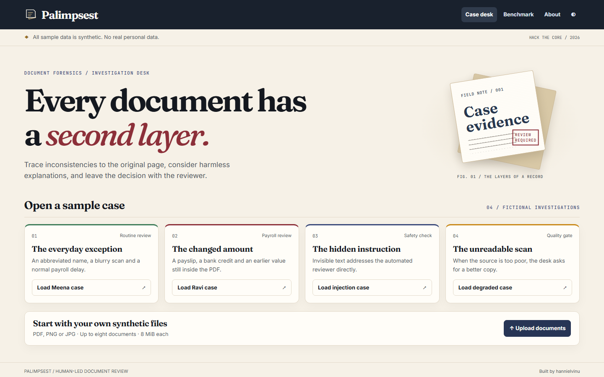
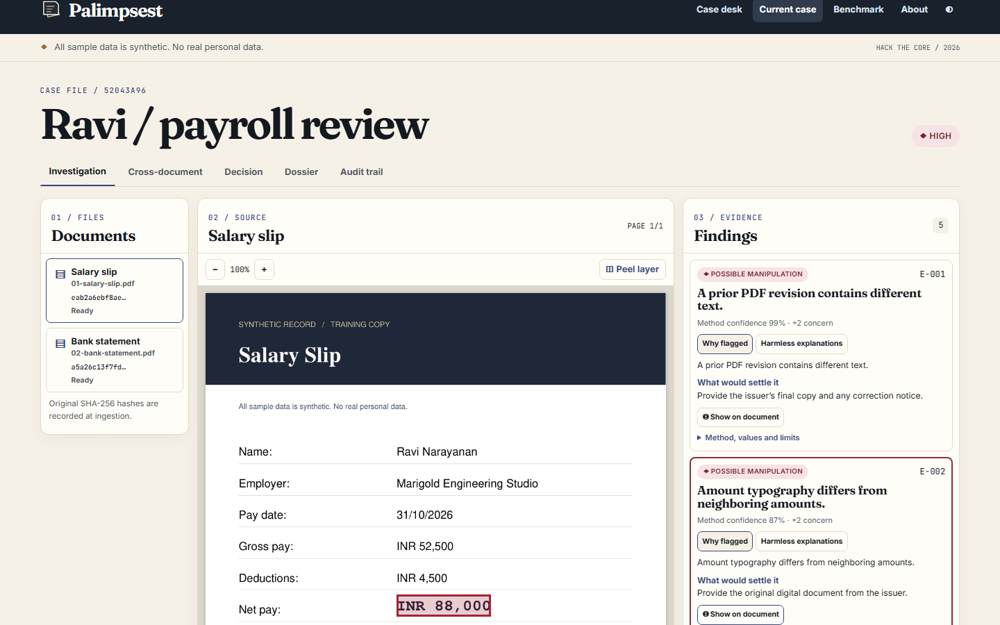
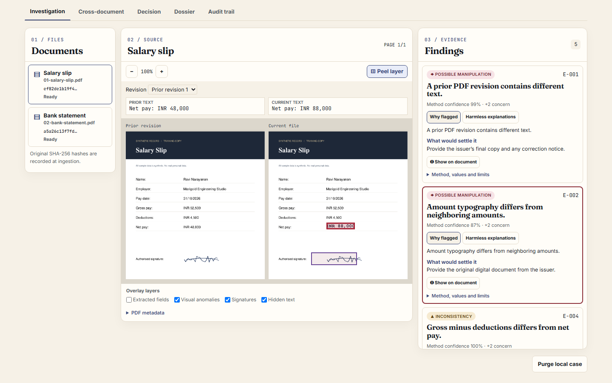
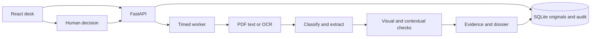

# Palimpsest

**Every document has a second layer.**

Palimpsest is a document investigation desk for DataOps Innovation Hackathon 2026 (Hack The Core), Problem Statement 1, **AI-Powered Document Forensics and Contextual Intelligence System**. It traces inconsistencies and possible manipulation to the original page, surfaces harmless explanations and leaves the decision with a human. A palimpsest is a manuscript scraped clean and rewritten, where traces of the first writing remain. An incremental PDF save can leave a similar trace.

**All sample data is synthetic. No real personal data.**

## Screenshots

These screenshots show actual runs of the local app.







## Meena and Ravi

**Meena Krishnan** submits a blurry payslip and a bank statement under “Meena K.” The documents use different date formats and the credit arrives a few days after payroll. The app explains the likely initial and normal pay window. Meena receives **LOW** concern.

**Ravi Narayanan** submits a payslip showing INR 88,000 in net pay. The amount's typography differs from neighboring amounts. Payroll arithmetic and the bank credit both point to INR 48,000. The signature regions are near-identical, and a retained PDF revision contains the earlier amount. Ravi receives **HIGH** concern with harmless explanations such as a payroll correction or an approved signature stamp.

The **injection** sample contains white text asking an automated reviewer to approve it. The text becomes evidence and the decision stays pending. The **degraded** sample returns **CANNOT DETERMINE** and asks for a clearer source.

## Features

- Multi-document cases, original SHA-256 hashes, field boxes, clickable evidence and related source regions.
- Embedded PDF extraction and Tesseract OCR for scans, with normalized amounts and dates.
- Contextual checks for identity, payroll, structure and pay-cycle consistency.
- Peel the Layer with retained revision recovery and side-by-side pages.
- Transparent concern scoring, plausible harmless explanations, applicant letter and reviewer actions.
- PDF dossier, hash-chain verification, local purge and reproducible evaluation.

## Live demo

Public deployment is pending. Run at **http://127.0.0.1:7860** or use the [hosting guide](docs/deployment.md).

## Two-minute quickstart

**Docker**

```sh
docker compose up --build
```

Open **http://127.0.0.1:7860** and load a sample. First-time dependency downloads can take longer.

**Local**

Install Python 3.11, Node.js 22 or later and Tesseract with English language data. On Debian/Ubuntu use `sudo apt-get install tesseract-ocr tesseract-ocr-eng`. On Windows use `winget install --id UB-Mannheim.TesseractOCR -e`.

```sh
python -m venv .venv
# PowerShell: .venv/Scripts/Activate.ps1
# Unix: source .venv/bin/activate
python -m pip install -r requirements-dev.txt
npm --prefix frontend ci
npm --prefix frontend run build
python -m uvicorn backend.app.main:app --host 127.0.0.1 --port 7860
```

## Environment variables

| Variable | Default | Purpose |
|---|---|---|
| `PORT` | 7860 in Docker | Container HTTP port. Locally use Uvicorn's port flag. |
| `PALIMPSEST_DATA` | `runtime/` locally | Directory for SQLite and original bytes. |
| `PALIMPSEST_DEMO_ONLY` | `0` locally, `1` in the image | Set to 1 on a public host to allow bundled files only. |
| `TESSERACT_CMD` | Platform lookup | Optional executable path. |

No API key is required. The narrative uses evidence-specific templates.

## Architecture



## Pipeline

1. **Ingest** validates originals and records SHA-256, case IDs and document IDs.
2. **Classify** scores headings and keywords within document layout rows.
3. **Extract** reads labeled fields, normalizes dates and amounts, and records method, confidence and page boxes. Fields remain unverified.
4. **Visual forensics** examines typography, signatures, hidden text, metadata and retained revisions.
5. **Context** checks required and repeated fields, payroll, dates, age and formats.
6. **Cross-document** compares identity fields and pay-cycle credits. The payroll window is −3 to +10 days and the tolerance is max(INR 100, 1% of net).
7. **Evidence** emits observations (0 points), inconsistencies (2), possible manipulation (2) and weak visual signals (1). Low is 0–1, moderate 2–5 and high 6+. Unreadable documents trigger cannot determine.
8. **Dossier** assembles the original hashes, findings, limits, audit head and human decision.

## Detectors

| Method | How it works | Known limit |
|---|---|---|
| Amount typography | Compares height, PDF font, alignment and raster stroke/edge statistics across money fields. | Mixed templates, scan blur and sparse fields affect the signal. |
| ELA | Recompresses a JPEG and measures local residual peaks. | Recompression and natural edges can affect the result. |
| Copy-move | Groups ORB feature matches under common translation. | Repeated template art can match. Rotation and low texture can hide duplicates. |
| Signature reuse | Crops labeled PDF signature regions and compares normalized ink with SSIM. | Shared approved stamps may look identical. |
| Layer peel | Validates prior xref/EOF boundaries with pikepdf and diffs page text. | Flattened history cannot be recovered. Graphic-only edits may be missed. |
| Hidden text | Checks opacity, position, size and contrast, then looks for reviewer-directed phrases. | Obfuscated or non-English instructions can evade phrase rules. |
| Context and correlation | Matches normalized fields, fuzzy names and same-cycle salary credit. | OCR, split credits and missing adjustments can yield conflicts. |

## Benchmark and robustness

**Synthetic, self-generated; a blind human-tampered set is planned.** A flag is any positive-point finding.

| Cases | Changed caught | Changed missed | Genuine flagged |
|---:|---:|---:|---:|
| 20 | 9 | 1 | 0 / 10 |

| Genuine scan condition | False alarms |
|---|---:|
| Clean raster | 0 / 5 |
| Blur | 0 / 5 |
| Rotation | 1 / 5 |
| JPEG compression | 0 / 5 |
| Noise | 0 / 5 |

[Per-detector results](data/benchmark/results/benchmark.md) · [Robustness results](data/benchmark/results/robustness.md) · [Case-level JSON](data/benchmark/results/benchmark.json)

## Capability matrix

| State | Scope |
|---|---|
| Implemented | Original hashes, retained PDF history, reviewer actions, dossier and audit. |
| Partial | Labeled English extraction, typography, ELA, ORB, signature reuse and hidden instruction heuristics. |
| Planned | Blind evaluation, calibrated thresholds, multilingual templates and optional constrained language-model rephrasing. |
| Unsupported | Issuer authentication, flattened PDF history recovery and automated verdicts. |

[Full capability matrix](docs/capability-matrix.md) · [Limitations](docs/limitations.md)

## Rubric map

| Criterion | Evidence |
|---|---|
| OCR & Information Extraction | PDF/OCR fields, normalized values and boxes. |
| Document Understanding | Missing, repeated and malformed fields, chronology and payroll rules. |
| Visual Forensic Analysis | Ravi typography, signature similarity and retained history. |
| Contextual Intelligence | Meena’s initial variant, Ravi’s pay-cycle bank conflict. |
| Evidence & Traceability | Evidence IDs, page overlays, source hashes and chain verification. |
| AI Reasoning & Explainability | Deterministic narratives, harmless explanations, point breakdown and verification requests. |
| Technical Implementation | FastAPI, React, Docker, tests and measured benchmarks. |
| Innovation | Recover prior PDF bytes and put plausible alternatives next to each finding. |

[Detailed rubric map](docs/rubric-map.md)

## Safety and ethics

The system reports observations, inconsistencies and possible manipulation. Reviewers can clear, request more documents or escalate with a reason. Concern points guide triage. Verify material findings with the issuer and give the applicant a chance to explain.

## Security model

Files are bounded and content-checked. Native parsing runs in timed workers, and the viewer only serves rendered images. Original bytes are held in local SQLite. Public mode accepts bundled samples only. Local mode is a single-user prototype. Case purge deletes originals, derived results and audit entries. Database administrators can rewrite an entire chain, so externally signed checkpoints are future work. [Architecture and security](docs/architecture.md#security-model)

## Standards referenced

Referenced for guidance, no formal compliance claimed. [ISO/IEC 27037](https://www.iso.org/standard/44381.html) · [ISO/IEC 27041](https://www.iso.org/standard/44405.html) · [ISO/IEC 27042](https://www.iso.org/standard/44406.html) · [NIST SP 800-86](https://csrc.nist.gov/pubs/sp/800/86/final) · [OWASP ML Top 10](https://owasp.org/projects/machine-learning-security-top-ten/)

## Licensing assumptions

The original project code uses [MIT](LICENSE). **PyMuPDF uses AGPL-3.0 or a commercial license.** Review the applicable AGPL source and network-service obligations before redistributing or hosting the combined application. The public repository includes the application source and build instructions.

| Direct dependency | License |
|---|---|
| Python, SQLite | PSF-2.0 and public domain, respectively |
| FastAPI, RapidFuzz | MIT |
| Uvicorn, NumPy, scikit-image, dateparser, ReportLab | BSD-3-Clause |
| pikepdf | MPL-2.0 |
| OpenCV, Tesseract, pytesseract, python-multipart, TypeScript | Apache-2.0 |
| Pillow | MIT-CMU for the tested version |
| React, Vite, Tailwind CSS, React plugin and React type definitions | MIT |
| Fraunces, Inter, JetBrains Mono | SIL Open Font License |
| pytest, python-pptx, qrcode | MIT |
| HTTPX | BSD-3-Clause |
| Playwright | Apache-2.0 |
| imageio-ffmpeg | BSD-2-Clause wrapper. Bundled FFmpeg terms depend on build and codecs. |

## Project structure

```text
backend/app/        API, storage, extraction, detectors and dossier
backend/tests/      Detector and API tests
frontend/           React, TypeScript and Tailwind
data/generator/     Seeded fixture generator
data/samples/       Four fictional cases
data/benchmark/     Reproducible outputs
docs/               Architecture, limitations, screenshots and demo materials
presentation/       Deck, PDF and builder
scripts/            Generation, benchmark, smoke tests and recording
```

## Testing

```sh
python -m pytest -q
npm --prefix frontend run check
npm --prefix frontend run build
python scripts/make_samples.py
python scripts/run_benchmark.py
python scripts/robustness_sweep.py
python scripts/smoke_http.py http://127.0.0.1:7860
python -m playwright install chromium
python scripts/capture_screens.py
```

For a blind set, place inputs under `data/benchmark/blind/inputs/<case-id>/` and the labels separately in `data/benchmark/blind/truth.json`, following the generated `data/benchmark/truth.json` schema. The pipeline receives only the inputs.

## Deployment and API

FastAPI serves the built frontend and API from one Docker image. [Hosting guide](docs/deployment.md)

Health is available at **/healthz** and OpenAPI at **/docs**.

| Method and path | Purpose |
|---|---|
| `POST /api/cases` | Create draft with JSON title. |
| `POST /api/cases/{id}/documents` | Upload multipart files using `files`. |
| `POST /api/cases/{id}/analyze` | Queue analysis. |
| `GET /api/cases/{id}/status` | Poll steps, state and timings. |
| `GET /api/cases/{id}/findings` | Read case fields, evidence and concern. |
| `GET /api/documents/{id}/render?page=1&revision=0` | Render a current or retained PDF page. |
| `GET /api/cases/{id}/crossmatrix` | Compare fields across documents. |
| `POST /api/cases/{id}/decision` | Record JSON action and reason. |
| `GET /api/cases/{id}/dossier.pdf` | Export the investigation PDF. |
| `GET /api/audit/verify?case_id={id}` | Verify and inspect the event chain. |
| `GET /api/capabilities` | Read capability labels and demo mode. |
| `GET /api/benchmark` | Read recorded results. |
| `POST /api/samples/{name}/load` | Load Meena, Ravi, injection or degraded case. |
| `DELETE /api/cases/{id}` | Purge a case. |

## Next 30 days

1. Obtain an independent blind corpus and report by template family and detector.
2. Improve deskew and extraction, then review thresholds against held-out data.
3. Add a stronger parser sandbox and signed audit checkpoints.
4. Test reviewer workflows with assistive technology and gather usability feedback.

**Built by hannielvinu**
