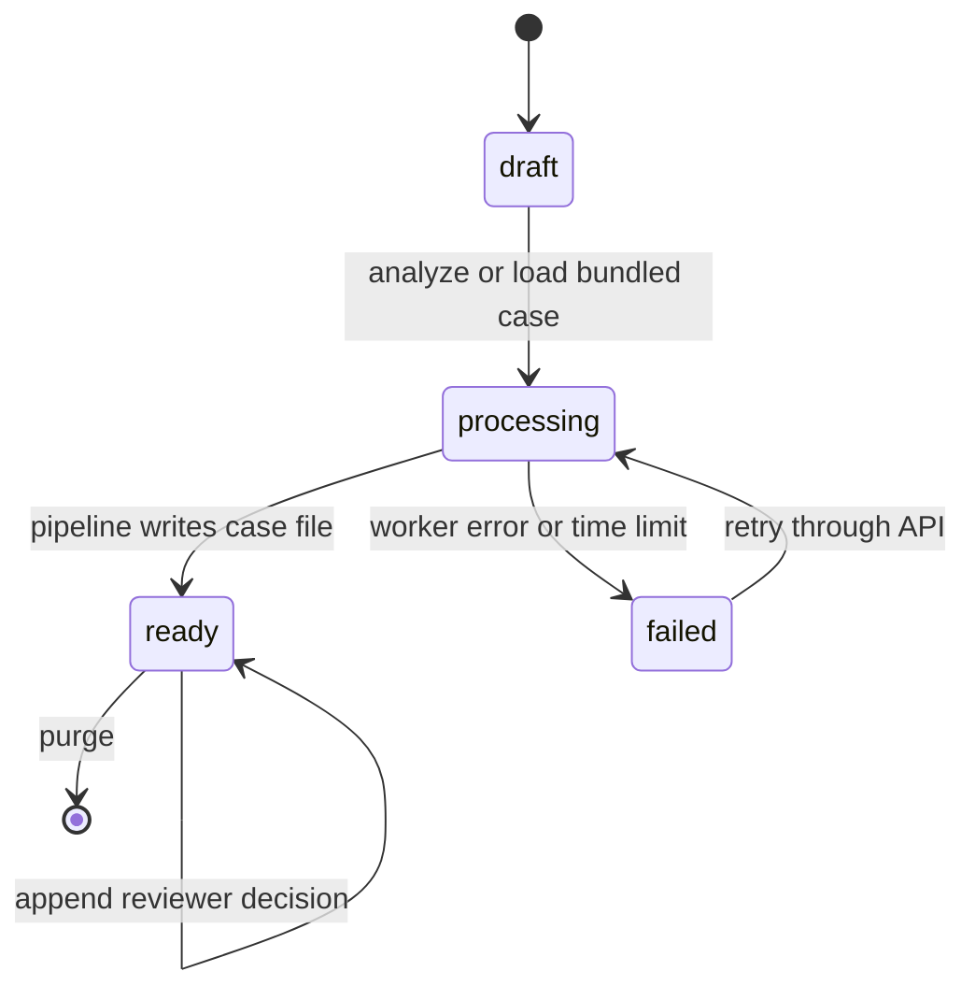

# Architecture

A single FastAPI origin serves Vite's static output and the API. The browser never receives active PDF content. The app renders source pages and retained revisions into PNG in a bounded subprocess.

```mermaid
flowchart LR
  UI[React investigation desk] --> API[FastAPI]
  API --> DB[(SQLite originals and audit)]
  API --> JOB[Timed analysis worker]
  JOB --> READ[Embedded PDF text or Tesseract]
  READ --> FIELD[Classify and extract labeled values]
  FIELD --> VIS[Visual and revision heuristics]
  VIS --> CHECK[Context and cross-document checks]
  CHECK --> EVID[Evidence and concern breakdown]
  EVID --> DB
  DB --> DOS[PDF dossier with audit head]
  UI --> REVIEW[Human decision]
  REVIEW --> API
```

## Case lifecycle

Ingest validates MIME against file content and stores the exact original bytes plus SHA-256. Each completed pipeline step and emitted finding is logged before analysis becomes ready. Audit entries store their predecessor and SHA-256 over that predecessor and canonical JSON. SQLite serializes writers and groups state updates with audit changes. Raster and finding boxes use normalized top-left page coordinates. Field confidence reflects extraction quality. Evidence confidence is a method heuristic.

## Security model

- Local mode is a single-user workstation. Its bind address defaults to loopback in the quickstart. This build has no user authentication or tenant separation.
- Public mode accepts bundled synthetic fixtures only and caps the store at 200 cases. Loading a bundled case clears completed demo cases older than an hour. Case identifiers are random capability-like identifiers. Possession of an identifier provides access to that case. Run public demos with ephemeral storage.
- Uploads allow PDF, PNG and JPEG only, match extension to magic or decoded image format, sanitize display names, cap document count, file bytes, page count and pixels, and use SQLite BLOBs with no user-derived filesystem paths.
- Workers use time limits for OCR, analysis and page rendering. Native parsing remains in the same operating-system account. An OS sandbox, upstream rate limits and stronger resource isolation are future work.
- The PDF viewer only displays rendered pixels and React-escaped strings. It never executes PDF actions or embeds a raw upload. Hidden instruction text is treated as evidence and excluded from field extraction.
- Local purge deletes case data and dependent rows in a transaction. SQLite secure deletion is enabled. Backups, browser downloads, operating-system snapshots and host-level recovery are outside its scope.
- Chain verification catches inconsistent contents in the database. An actor with full database control can rewrite the chain or truncate its tail. For stronger custody, publish signed checkpoints to a separate trust domain.
- No third-party API receives document bytes or findings. The browser may load public typefaces from Google Fonts and falls back to system fonts offline.

## Standards referenced

Referenced for guidance, no formal compliance claimed. ISO/IEC 27037 covers evidence handling, ISO/IEC 27041 covers suitability of investigative methods, and ISO/IEC 27042 covers analysis and interpretation. NIST SP 800-86 and the OWASP Machine Learning Security Top Ten inform reproducibility and hostile-input handling.

[ISO/IEC 27037](https://www.iso.org/standard/44381.html) · [ISO/IEC 27041](https://www.iso.org/standard/44405.html) · [ISO/IEC 27042](https://www.iso.org/standard/44406.html) · [NIST SP 800-86](https://csrc.nist.gov/pubs/sp/800/86/final) · [OWASP ML Top 10](https://owasp.org/projects/machine-learning-security-top-ten/)
